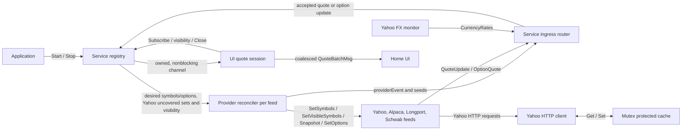

# Market-data ownership and quote flow

This document describes the active subscription stream. One-shot price commands use separate helpers. See the [UI message-flow guide](ui-msg-flow.md) for rendering and embedding.

## Owners and synchronization

Channels carry work and results between components. Mutexes protect in-memory state that callers read or update directly. The service never holds its registry lock during `SetSymbols`, `Snapshot`, `SetOptions`, or HTTP work.

| Component | State | Work and communication |
|---|---|---|
| Application ([`tui/main.go`](../tui/main.go)) | Application lifetime | Starts and stops market data; closes the backend after the UI returns. |
| Service registry ([`mktdata.go`](../internal/marketdata/mktdata.go), [`subscription.go`](../internal/marketdata/subscription.go)) | Subscriptions, option subscriptions, per-symbol and per-contract Yahoo coverage, FX quotes, service lifecycle | `Service.mu` guards local attach, coverage changes, fanout, channel close, status, and feed registration. `Subscribe` returns after local attach. |
| Provider reconciler ([`provider.go`](../internal/marketdata/provider.go)) | One feed's logical desired/applied symbols and options, Yahoo periodic membership, ordered visibility, generation, retry delay, last error | One goroutine per provider coalesces kicks, calls its feed outside `Service.mu`, retries failures, and sends `providerEvent` results. `Status` reports logical reconciliation and pending work; Yahoo periodic membership is tracked internally. |
| Quote router ([`router.go`](../internal/marketdata/router.go)) | Provider generations, pending future-generation quotes, revisions, Yahoo metadata | The service ingress loop accepts live and seed quotes and prunes symbols that leave the registry. |
| FX conversion ([`fx.go`](../internal/marketdata/fx.go)) | No mutable state | Converts rate maps to quotes and selects requested currency pairs. |
| Shared stream policy ([`subscriptions.go`](../shared/streaming/subscriptions.go)) | Server-acknowledged and rejected symbols per connection | Runs inside each streaming feed worker. Subscribe/unsubscribe callbacks acknowledge atomic changes; provider adapters classify capacity errors. |
| Alpaca feed owner ([`feed.go`](../internal/marketdata/mktfeed/alpaca/feed.go)) | Symbols, quote cache, timestamps, generations, feed lifecycle | Serializes feed commands and callback events; snapshot and stream workers do blocking work. |
| Longport feed owner, extension build ([`longport.go`](../extension/mktfeed/longport/longport.go)) | Symbols, quote cache, revisions, feed lifecycle | Serializes subscription and snapshot work; SDK callbacks enqueue events. |
| Schwab feed owner, extension build ([`feed.go`](../extension/mktfeed/schwab/feed.go)) | REST and stream episode state, option revisions | Serializes feed operations and acknowledges symbol changes to the reconciler. |
| Yahoo price owner ([`monitor.go`](../internal/marketdata/yahoo/monitor-price/monitor.go)) | Logical symbols, periodic equity symbols, quote snapshots and revisions, option contracts and last prices, polling timer | Coalesces refresh work, retains snapshots across subset polls, and publishes source-tagged quote and option updates. The timer stays active when both periodic equities and option contracts are empty. |
| Yahoo FX owner ([`monitor.go`](../internal/marketdata/yahoo/monitor-currency-rates/monitor.go)) | Target currency and requested rates | Coalesces rate requests and publishes rate maps. |
| Yahoo HTTP client ([`unary.go`](../internal/marketdata/yahoo/unary/unary.go)) | Cookies and crumb guarded by a mutex | Runs price, FX, and option requests concurrently; one refresh at a time establishes a session. |
| Cache ([`cache.go`](../internal/marketdata/cache/cache.go)) | Entries and file writes guarded by a mutex | Returns copied payloads; callers decode their own values. |
| UI session ([`session.go`](../tui/ui/session.go)) | One `Subscription`, ordered visibility and a coalescing receiver | Attaches all symbols with initial visibility, updates display priorities, reads `Updates()`, and calls `Close()` on shutdown. |
| Home UI event loop ([`home-screen.go`](../tui/ui/home-screen.go)) | UI quote cache, portfolio, summaries, watchlists, layout | Converts transport updates to local quotes and refreshes affected views. |

## Wiring



`Start` creates the configured feeds, default Yahoo feed, FX monitor, and provider reconcilers. Prestart subscriptions enter the registry before providers start. Each reconciler reads the latest desired state when kicked, so a burst of changes can become one feed call. It applies logical symbols, Yahoo's separate periodic subset, options and visibility outside `Service.mu`, then publishes generation and snapshot results to the ingress loop. Failed applies remain pending and retry with backoff. Logical subscriptions have no stream capacity limit; feeds handle capacity internally, so parked stream symbols do not cause service reconciliation failures.

`Subscribe(symbols)` returns a service-owned `Subscription`. `SubscribeOption(options)` returns an `OptionSubscription`. Both expose `Updates()` and `Close()`. The configured feed receives the full option union when it implements `OptionFeed`; otherwise Yahoo is selected. When another feed is selected, Yahoo also receives every not-yet-covered contract as fallback. Yahoo receives only the uncovered union when Yahoo itself is selected. Option contracts are normalized by ticker, expiry, strike and call/put. `OptionQuote.QuoteSource` identifies Yahoo, Alpaca or Schwab. A demanded contract becomes covered after a registered non-Yahoo feed sends a positive finite bid, ask or last price; the first handoff logs at INFO. Yahoo then stops polling that contract; delayed Yahoo and unattributed updates cannot replace its price. The first live quote does not inherit Yahoo's last price, while later live updates without a last retain the last live value. Coverage ends synchronously when the final subscriber for that contract closes; the cached latest quote remains available.

## Stream capacity and watchlist priorities

Yahoo keeps the full subscribed equity union as its logical membership, excluding configured FX pairs handled by the currency monitor. Its separate periodic set omits equities already covered by another feed, while Yahoo can still provide descriptive data for them. The option set is reconciled independently and omits covered contracts. Empty sets issue no corresponding HTTP requests; the monitor and timer stay alive and resume polling when membership changes. Adding a symbol fetches its initial data while retaining unchanged snapshots. The UI attaches its full symbol union and initial ordered visible list atomically through `SubscribeWithVisibility`; later `Subscription.SetVisibleSymbols` calls change only priority metadata. The reconciler forwards visibility through the optional feed `VisibilityFeed` capability. It never chooses a stream subset, inspects quota errors, or changes Yahoo's polling set on watchlist switches. `Status().AppliedSymbols` describes logical feed reconciliation, not Yahoo's periodic subset or physical stream capacity.

Alpaca, Longport and Schwab use the same worker-owned stream policy. It tries visible symbols in watchlist order, then fills spare slots with background symbols. Successful subscriptions remain active until removed logically or until a higher-priority visible symbol needs their capacity. Atomic batch rejections are split into smaller attempts; only acknowledged successes enter the applied set. Per-request caps are separate from total capacity (Longport bounds requests to 500 symbols).

On a capacity rejection, the helper evicts a background subscription, or a later visible symbol when the visible list itself exceeds capacity, and retries the higher-priority visible symbol. Visible overflow is covered by Yahoo, without rotation. Rejected background symbols remain logically desired and parked until inputs change. Repeating the same settled desired/visible set does not retry or churn subscriptions. Ordinary errors retain truthful partial state and remain retryable. Removing subscriptions also changes bookkeeping only after acknowledgment.

Alpaca and Longport retain SDK reconnect replay of acknowledged subscriptions. Schwab replans desired symbols and current visibility on a fresh connection. Capacity is classified inside each adapter: Alpaca uses its SDK symbol-limit error, Longport uses documented business error 301605, and Schwab recognizes explicit capacity text in broker rejection acknowledgments without guessing undocumented numeric codes. Options retain their independent subscription path.

Stream subscription acknowledgments, rejections, evictions and retries log at INFO. Symbol lists and operation details log at DEBUG. Canceled queued priority requests are ignored before execution. Alpaca and Longport commit priorities after successful worker reconciliation; Schwab accepts visibility as local desired metadata and reports asynchronous stream errors separately. A canceled UI session cannot forward later visibility updates.

[`QuoteUpdate`](../internal/types.go) carries source, symbol, metadata, generation, revision, and an owned price payload. The router rejects stale generations and older revisions and rejects a snapshot seed when its target subscription has closed or the same provider has delivered a newer update for that symbol since the seed was requested. It caches Yahoo's name, market capitalization, volume and 52-week range. For other feeds, Yahoo fills a missing name and zero-valued descriptive fields while preserving populated provider fields. Longport maps app symbols such as `AAPL` to provider symbols such as `AAPL.US` and preserves the provider symbol in metadata. Accepted updates are cloned per subscriber. A full channel is coalesced by symbol, preserving the newest quote for every subscribed symbol without blocking other subscribers.

An accepted, usable price from a registered non-Yahoo feed covers that demanded equity symbol and logs the first Yahoo handoff at INFO. Coverage lasts until the final subscription containing that symbol closes. While covered, Yahoo price values do not update `LatestPrice` or reach subscribers. Yahoo can still enrich the retained live quote with missing name, market capitalization, volume and 52-week range; enrichment preserves the live price and source and is delivered when metadata changes. A late subscriber receives the retained enriched quote. Once coverage ends, Yahoo prices can be accepted again. The service keeps the public latest-price cache across close. The home UI applies accepted updates in arrival order; an update with no price preserves the existing local price while applying metadata. The UI receiver drains a bounded batch and keeps the latest update per symbol.

## Shutdown and backpressure

Live quote ingress defaults to a 10-update buffer. Set `app.mkt-feed.quote-queue-size` to a positive integer to change that capacity. Subscription channels reserve at least 64 slots and at least one slot per subscribed symbol. Full quote channels coalesce repeated symbols, preserving their latest state; metadata-only updates retain a queued price. Option delivery remains nonblocking and may drop updates under sustained load. `Subscription.Close` and `OptionSubscription.Close` remove registry entries and close their channels while holding `Service.mu`, so the ingress loop cannot send after close. Equity and option coverage is removed on final close before provider reconciliation. Service stop closes remaining subscription channels, cancels reconcilers, waits for them, stops feeds and the FX monitor, and closes idle Yahoo HTTP connections. Repeated stop calls return the same result.

## Concurrency checks

Run the race detector for both builds when changing the service, feeds, or UI subscription path. Keep `GOCACHE` outside the workspace and remove the temporary cache afterward:

```sh
GOCACHE=/tmp/urphin-marketdata-race-cache go test -race ./internal/marketdata/... ./tui/ui ./tui/setup
GOCACHE=/tmp/urphin-marketdata-race-cache go test -race -tags extension ./internal/marketdata/... ./extension/mktfeed/... ./tui/ui ./tui/setup
rm -r /tmp/urphin-marketdata-race-cache
```

Repeat focused concurrency tests to exercise more interleavings, for example:

```sh
GOCACHE=/tmp/urphin-marketdata-race-cache go test -race -count=20 ./internal/marketdata -run 'Test(ConcurrentRoutingAndSubscriberChanges|DelayedSnapshotCannotAttachAfterUnsubscribeAndResubscribe|StopWaitsForStalledSubscriptionProviderCall)$'
rm -r /tmp/urphin-marketdata-race-cache
```

Use `-count` only with ordinary Go test packages; Ginkgo suites in the UI reject counts above one. Run `make check`, then `make public` and `make extension` sequentially for shared-code changes. A clean `-race` run means no data race occurred on the paths exercised. It does not prove that every interleaving is safe or detect deadlocks, lost updates, and shutdown stalls; the focused tests above cover those behaviors with explicit assertions.

## Benchmark reference

[`BenchmarkMarketDataProviderIngress`](../internal/marketdata/mktdata_test.go) measures one serial quote handoff from a fake provider through the service router to one subscriber. Setup waits for initial provider reconciliation. The benchmark includes quote creation, channel transfer, generation/revision checks, cloning, delivery, and receiver consumption. It excludes subscription, reconciliation, network, SDK callbacks, UI rendering, and bursts. It is a sequential latency reference, not a saturated-throughput claim.

Command (use a temporary Go cache outside the workspace):

```sh
GOCACHE=/tmp/urphin-benchmark-cache GOMAXPROCS=1 go test ./internal/marketdata -run '^$' \
  -bench '^BenchmarkMarketDataProviderIngress$' -benchmem -benchtime=2s -count=5 -cpu=1
```

The 2026-11-10 reference on Go `go1.27.3-X:nodwarf5`, Linux/amd64, Intel i5-12400 measured 792.0 ns/op, 128 B/op, and 2 allocs/op (mean of five runs). A same-day run of the phase 0–2 checkpoint (`c932ef6`) measured 838.2, 877.2, and 845.6 ns/op (mean 853.7). The migration measured 861.4, 861.5, 841.2, 845.8, and 846.6 ns/op (mean **851.3**). Both used 128 B/op and 2 allocs/op. The paired results are within measurement noise; the older 792 ns reference reflects a different run environment. The subscriber channel capacity changed from 1 to 64, so future comparisons should record that difference alongside the Go version, OS/architecture, CPU, command, and all runs.

## Unchecked follow-ups

- **FOLLOW.1:** Plan or fix Alpaca missing-snapshot handling, daily metadata refresh, and authoritative market-state mapping. Stream-capacity partial success is handled internally by the shared policy.
- **FOLLOW.2:** Plan or fix FX expiry, periodic refresh and retry policy, and post-market percentage math.
- **FOLLOW.3:** Define cross-process cache transaction guarantees. The in-process mutex and unique temporary files do not provide cross-process read/merge/write locking.
