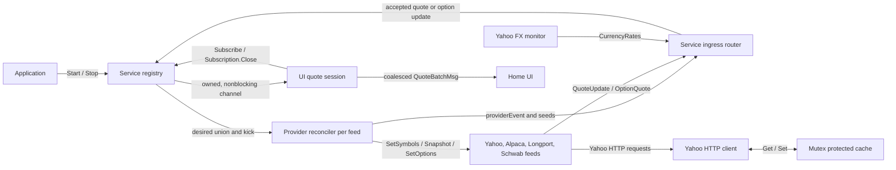

# Market-data ownership and quote flow

This document describes the active subscription stream. One-shot price commands use separate helpers. See the [UI message-flow guide](ui-msg-flow.md) for rendering and embedding.

## Owners and synchronization

Channels carry work and results between components. Mutexes protect in-memory state that callers read or update directly. The service never holds its registry lock during `SetSymbols`, `Snapshot`, `SetOptions`, or HTTP work.

| Component | State | Work and communication |
|---|---|---|
| Application ([`tui/main.go`](../tui/main.go)) | Application lifetime | Starts and stops market data; closes the backend after the UI returns. |
| Service registry ([`mktdata.go`](../internal/marketdata/mktdata.go), [`subscription.go`](../internal/marketdata/subscription.go)) | Subscriptions, option subscriptions, FX quotes, service lifecycle | `Service.mu` guards local attach, fanout, channel close, status, and feed registration. `Subscribe` returns after local attach. |
| Provider reconciler ([`provider.go`](../internal/marketdata/provider.go)) | One feed's desired/applied symbols and options, generation, retry delay, last error | One goroutine per provider coalesces kicks, calls its feed outside `Service.mu`, retries failures, and sends `providerEvent` results. `Status` exposes reconciliation state. |
| Quote router ([`router.go`](../internal/marketdata/router.go)) | Provider generations, pending future-generation quotes, revisions, Yahoo names | The service ingress loop accepts live and seed quotes and prunes symbols that leave the registry. |
| FX conversion ([`fx.go`](../internal/marketdata/fx.go)) | No mutable state | Converts rate maps to quotes and selects requested currency pairs. |
| Alpaca feed owner ([`feed.go`](../internal/marketdata/mktfeed/alpaca/feed.go)) | Symbols, quote cache, timestamps, generations, feed lifecycle | Serializes feed commands and callback events; snapshot and stream workers do blocking work. |
| Longport feed owner, extension build ([`longport.go`](../extension/mktfeed/longport/longport.go)) | Symbols, quote cache, revisions, feed lifecycle | Serializes subscription and snapshot work; SDK callbacks enqueue events. |
| Schwab feed owner, extension build ([`feed.go`](../extension/mktfeed/schwab/feed.go)) | REST and stream episode state, option revisions | Serializes feed operations and acknowledges symbol changes to the reconciler. |
| Yahoo price owner ([`monitor.go`](../internal/marketdata/yahoo/monitor-price/monitor.go)) | Symbols, quote cache, revisions, polling timer | Coalesces refresh work and publishes quote and option updates. |
| Yahoo FX owner ([`monitor.go`](../internal/marketdata/yahoo/monitor-currency-rates/monitor.go)) | Target currency and requested rates | Coalesces rate requests and publishes rate maps. |
| Yahoo HTTP client ([`unary.go`](../internal/marketdata/yahoo/unary/unary.go)) | Cookies and crumb guarded by a mutex | Runs price, FX, and option requests concurrently; one refresh at a time establishes a session. |
| Cache ([`cache.go`](../internal/marketdata/cache/cache.go)) | Entries and file writes guarded by a mutex | Returns copied payloads; callers decode their own values. |
| UI session ([`session.go`](../tui/ui/session.go)) | One `Subscription` and a coalescing receiver | Calls `Subscribe` once, reads `Updates()`, and calls `Close()` on shutdown. |
| Home UI event loop ([`home-screen.go`](../tui/ui/home-screen.go)) | UI quote cache, portfolio, summaries, watchlists, layout | Converts transport updates to local quotes and refreshes affected views. |

## Wiring



`Start` creates the configured feeds, default Yahoo feed, FX monitor, and provider reconcilers. Prestart subscriptions enter the registry before the providers start. Each reconciler reads the latest desired union when kicked, so a burst of changes can become one provider call. It publishes a generation and snapshot result to the ingress loop. Failures remain in `Status().LastError` and retry with backoff; they do not undo local subscriptions.

`Subscribe(symbols)` returns a service-owned `Subscription`. `SubscribeOption(options)` returns an `OptionSubscription`. Both expose `Updates()` and `Close()`. The selected option provider alone receives the option union through `SetOptions`; removing the last option subscription sends an empty union. Option quotes are normalized and delivered to matching option subscriptions without passing through the price-generation router.

[`QuoteUpdate`](../internal/types.go) carries source, symbol, metadata, generation, revision, and an owned price payload. The router rejects stale generations and older revisions, preserves Yahoo names, and rejects seed quotes after a newer live quote or subscription close. Longport maps app symbols such as `AAPL` to provider symbols such as `AAPL.US` and preserves the provider symbol in metadata. Accepted updates are cloned per subscriber. A full channel drops its update without blocking other subscribers.

There is no cross-provider price priority or field merge. The home UI applies accepted updates in arrival order; an update with no price preserves the existing local price while applying metadata. The UI receiver drains a bounded batch and keeps the latest update per symbol.

## Shutdown and backpressure

Live quote ingress has a 10-update buffer; subscription channels have a 64-update buffer. Delivery is nonblocking and may drop updates under sustained load. `Subscription.Close` removes its registry entry and closes its channel while holding `Service.mu`, so the ingress loop cannot send after close. Service stop closes remaining subscription channels, cancels reconcilers, waits for them, stops feeds and the FX monitor, and closes idle Yahoo HTTP connections. Repeated stop calls return the same result.

## Concurrency checks

Run the race detector for both builds when changing the service, feeds, or UI subscription path. Keep `GOCACHE` outside the workspace and remove the temporary cache afterward:

```sh
GOCACHE=/tmp/urphin-marketdata-race-cache go test -race ./internal/marketdata/... ./tui/ui ./tui/setup
GOCACHE=/tmp/urphin-marketdata-race-cache go test -race -tags extension ./internal/marketdata/... ./extension/mktfeed/... ./tui/ui ./tui/setup
rm -r /tmp/urphin-marketdata-race-cache
```

Repeat focused concurrency tests to exercise more interleavings, for example:

```sh
GOCACHE=/tmp/urphin-marketdata-race-cache go test -race -count=20 ./internal/marketdata -run 'Test(ConcurrentRoutingAndSubscriberChanges|DelayedSnapshotCannotAttachAfterUnsubscribeAndResubscribe|StopWaitsForStalledSubscriptionProviderCall)$'
rm -r /tmp/urphin-marketdata-race-cache
```

Use `-count` only with ordinary Go test packages; Ginkgo suites in the UI reject counts above one. Run `make check`, then `make public` and `make extension` sequentially for shared-code changes. A clean `-race` run means no data race occurred on the paths exercised. It does not prove that every interleaving is safe or detect deadlocks, lost updates, and shutdown stalls; the focused tests above cover those behaviors with explicit assertions.

## Benchmark reference

[`BenchmarkMarketDataProviderIngress`](../internal/marketdata/mktdata_test.go) measures one serial quote handoff from a fake provider through the service router to one subscriber. Setup waits for initial provider reconciliation. The benchmark includes quote creation, channel transfer, generation/revision checks, cloning, delivery, and receiver consumption. It excludes subscription, reconciliation, network, SDK callbacks, UI rendering, and bursts. It is a sequential latency reference, not a saturated-throughput claim.

Command (use a temporary Go cache outside the workspace):

```sh
GOCACHE=/tmp/urphin-benchmark-cache GOMAXPROCS=1 go test ./internal/marketdata -run '^$' \
  -bench '^BenchmarkMarketDataProviderIngress$' -benchmem -benchtime=2s -count=5 -cpu=1
```

The 2026-11-10 reference on Go `go1.27.3-X:nodwarf5`, Linux/amd64, Intel i5-12400 measured 792.0 ns/op, 128 B/op, and 2 allocs/op (mean of five runs). A same-day run of the phase 0–2 checkpoint (`c932ef6`) measured 838.2, 877.2, and 845.6 ns/op (mean 853.7). The migration measured 861.4, 861.5, 841.2, 845.8, and 846.6 ns/op (mean **851.3**). Both used 128 B/op and 2 allocs/op. The paired results are within measurement noise; the older 792 ns reference reflects a different run environment. The subscriber channel capacity changed from 1 to 64, so future comparisons should record that difference alongside the Go version, OS/architecture, CPU, command, and all runs.

## Unchecked follow-ups

- **FOLLOW.1:** Plan or fix Alpaca partial-symbol success, daily metadata refresh, and authoritative market-state mapping.
- **FOLLOW.2:** Plan or fix FX expiry, periodic refresh and retry policy, and post-market percentage math.
- **FOLLOW.3:** Define cross-process cache transaction guarantees. The in-process mutex and unique temporary files do not provide cross-process read/merge/write locking.
- **PHASE2.1:** On explicit instruction, retain Yahoo metadata subscriptions, prefer valid non-Yahoo prices, preserve field provenance, and report fallback status.
