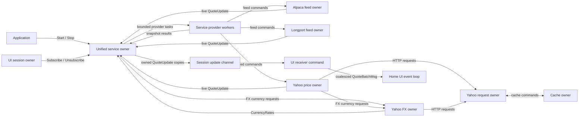

# Market-data actor model

This document describes current market-data ownership and quote wiring. For UI startup, rendering, and embedding details, see the [UI message-flow guide](ui-msg-flow.md).

The diagram covers the subscription stream from provider updates to the home UI. One-shot price commands use separate market-data helpers; Coinbase monitor internals are outside this active stream.

## Owners

An owner is the goroutine that serializes one component's mutable state. Public methods submit commands; provider callbacks and worker completions submit events. The service and feed owners delegate blocking provider/SDK work to workers. Yahoo HTTP uses a dedicated serial request owner, and the cache owner performs serialized cache I/O.

| Owner | State owned | Work and communication |
|---|---|---|
| Application ([`tui/main.go`](../tui/main.go)) | Application lifetime | Starts and stops `MktData`; closes the backend after `ui.Run` returns. |
| Unified service ([`mktdata.go`](../internal/marketdata/mktdata.go), `mktDataOwner`) | Subscribers, requested-symbol union, provider handles and generations, FX quote cache, quote versions, service lifecycle | Accepts API commands, dispatches provider tasks, accepts snapshots/live updates, and fans out subscriber quotes. |
| Service provider worker | One provider's serialized operations | Runs `SetSymbols`, `Start`, and snapshot requests outside the service owner; returns `providerResult` messages. |
| Alpaca feed owner ([`feed.go`](../internal/marketdata/mktfeed/alpaca/feed.go)) | Desired/applied symbols, quote cache, timestamps, generations, feed lifecycle | Handles feed commands and callback events. Snapshot and stream workers do blocking work; callbacks only enqueue events. |
| Longport feed owner ([`longport.go`](../extension/mktfeed/longport/longport.go)) | Desired symbols, quote cache, revisions, feed lifecycle | Handles feed commands and quote events. One API worker serializes subscriptions and snapshots; SDK callbacks only enqueue events. |
| Yahoo price owner ([`monitor.go`](../internal/marketdata/yahoo/monitor-price/monitor.go)) | Symbols, quote cache, revisions, polling timer, request state | Coalesces refresh work, calls the Yahoo request owner, and publishes quote updates and currency requests. |
| Yahoo FX owner ([`monitor.go`](../internal/marketdata/yahoo/monitor-currency-rates/monitor.go)) | Target currency, requested currencies, cached rates, request state | Coalesces rate requests, uses the Yahoo request owner and cache, and publishes rate maps. |
| Yahoo request owner ([`unary.go`](../internal/marketdata/yahoo/unary/unary.go)) | HTTP client, cookies, crumb, serialized request state | Executes context-bound Yahoo HTTP requests serially for price and FX owners. |
| Cache owner ([`cache.go`](../internal/marketdata/cache/cache.go)) | In-memory entries and file operations | Serializes cache commands and returns copied payloads; callers decode their own values. |
| UI session owner ([`session.go`](../tui/ui/session.go), `quoteSession`) | Subscribe attempts/retries, detach ordering, output-channel lifetime | Waits for receiver readiness, retries subscription, resolves pending subscribe before detach, then closes its channel. |
| Home UI event loop ([`home-screen.go`](../tui/ui/home-screen.go)) | UI quote cache, portfolio, summaries, watchlists and layout | Converts owned `QuoteUpdate` values to local `AssetQuote` values and updates UI state. |

## Wiring



### Startup and provider work

1. The application calls `Start` with a cloned configuration. The service owner creates its bounded quote, error, rate, and FX-request channels, the cache, Yahoo request owner, and Yahoo FX owner. It creates the default Yahoo price owner when no Yahoo feed is already registered, then creates enabled provider feeds and their service workers.
2. `Subscribe` registers an ID and caller-owned update channel, adds symbols to that subscriber, and recomputes the union requested from providers. Reusing an ID requires the same channel.
3. The service owner captures subscriber membership epochs and quote-sequence markers for seed results. It queues `SetSymbols`, `Start`, and snapshot tasks on each provider worker. Workers call the provider facade and return results to the service owner; the owner loop remains available for commands and live updates.
4. Providers publish live `QuoteUpdate` values to the service quote channel. Alpaca and Longport SDK callbacks only enqueue feed events; each feed owner validates and caches data before publishing. Longport maps Yahoo-style app tickers to provider tickers, such as `AAPL` to `AAPL.US`, and retains provider symbols in `Meta.SymbolInSourceAPI`. The selected option provider publishes `OptionQuote` values; Yahoo remains available for ordinary quotes and FX. The Yahoo price owner accepts fetch results, increments per-symbol revisions, and publishes updates. FX results arrive as rate maps; the service owner converts them to FX quotes and caches those local values.

### Quote acceptance and delivery

[`QuoteUpdate`](../internal/types.go) is the transport envelope. It carries symbol, class, source, metadata, provider generation, revision, and `*QuotePrice`. A successful send transfers exclusive ownership of the payload to the receiver. A producer keeps ownership only when enqueue fails. Providers create owned payloads, and the service clones each subscriber payload independently.

The service owner rejects updates from stale provider generations and older revisions. It also rejects seed snapshots when a newer live quote or a changed subscriber membership epoch makes the seed obsolete. Accepted updates are matched against each subscriber's symbols and sent nonblocking. A full subscriber channel drops that update without delaying other subscribers or service commands.

There is no cross-provider price priority or field merge. The service delivers accepted updates from enabled providers. The home event loop applies updates in arrival order; a nil price preserves the existing local price while applying the update's metadata.

The UI session has one receiver. It waits for one update, drains a bounded number of queued updates, and keeps the latest update per symbol in a `QuoteBatchMsg`. The home event loop converts each owned transport update to local state, updates its quote cache and refreshes affected watchlist and summary views.

## Shutdown and backpressure

- Service API commands use a buffered command mailbox and buffered per-command replies. Provider tasks run on bounded queues; worker results return to the owner through a separate results channel.
- Live quote ingress is buffered to 10 updates. Service fanout is nonblocking. The UI session channel is sized to at least 64 updates or twice the symbol count; it is not a lossless queue under sustained traffic.
- UI close cancels receiver and retry work, waits for an in-flight `Subscribe`, then calls `Unsubscribe`. The session closes its channel only after the service confirms local detach. Provider cleanup errors remain reportable without allowing future sends to the detached channel.
- Service stop cancels owned work, joins provider workers, stops provider feeds and Yahoo FX, closes the Yahoo request owner, closes the cache, then publishes one terminal result. Repeated stop calls observe the same terminal outcome.

## Benchmark reference

[`BenchmarkMarketDataProviderIngress`](../internal/marketdata/mktdata_test.go) measures one serial quote through the provider publisher channel, service owner, and one subscriber. It includes `NewQuoteUpdate`, provider-channel enqueue, owner validation/version bookkeeping, per-subscriber price cloning, delivery, and receiver consumption. It excludes service startup, subscription setup, shutdown, network calls, SDK callbacks, UI rendering, and multi-quote bursts.

In Go benchmark output, `op` means one loop iteration: construct one `QuoteUpdate`, send it through the provider channel, and receive its delivery from the subscriber.

The benchmark keeps one quote in flight at a time. It uses one Yahoo-source fake publisher, one symbol (`AAPL`), one subscriber, a service ingress channel with capacity 10, and a subscriber channel with capacity 1. The publisher creates a fresh owned payload each iteration; the receiver drains it before the next iteration. This gives a repeatable sequential latency/allocation reference, not a saturated-throughput result.

Command:

```sh
GOCACHE="$(pwd)/.task-go-cache" GOMAXPROCS=1 go test ./internal/marketdata -run '^$' \
  -bench '^BenchmarkMarketDataProviderIngress$' -benchmem \
  -benchtime=2s -count=5 -cpu=1
```

Reference run (2026-11-10): Go `go1.27.3-X:nodwarf5`, Linux/amd64, 12th Gen Intel Core i5-12400, `GOMAXPROCS=1`, `-cpu=1`.

| Run | ns/op | B/op | allocs/op |
|---:|---:|---:|---:|
| 1 | 796.9 | 128 | 2 |
| 2 | 795.5 | 128 | 2 |
| 3 | 785.1 | 128 | 2 |
| 4 | 790.4 | 128 | 2 |
| 5 | 792.1 | 128 | 2 |
| Mean | 792.0 | 128 | 2 |

The reciprocal serial rate is about 1.26 million deliveries per second; this is not a saturated-throughput claim. Both allocations are consistent with the provider-owned price payload and its independent subscriber copy.

Record the Go version, OS/architecture, CPU, exact command, and all result lines with future benchmark updates. Keep the workload and channel/subscriber counts fixed when comparing refactors. More subscribers add one price copy per recipient.

## Unchecked follow-ups

These remain outside the actor refactor:

- **FOLLOW.1:** Plan or fix Alpaca partial-symbol success, daily metadata refresh, and authoritative market-state mapping (review findings 2, 4, and 5).
- **FOLLOW.2:** Plan or fix FX expiry, periodic refresh and retry policy, and post-market percentage math (review findings 11 and 14).
- **FOLLOW.3:** Define cross-process cache transaction guarantees. The cache owner and unique temporary files serialize one process; they do not provide cross-process read/merge/write locking.
- **PHASE2.1:** On explicit instruction, retain Yahoo metadata subscriptions, prefer valid non-Yahoo `QuotePrice` data, preserve field presence/provenance, and report fallback status. Do not add enrichment-driven Yahoo unsubscribe or shutdown.
