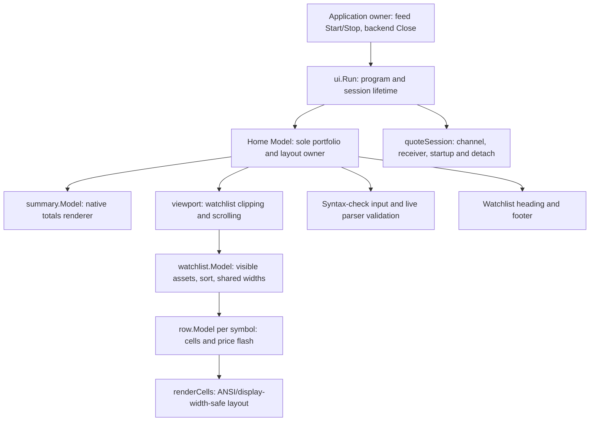
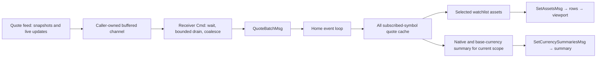

# UI message flow and embedding guide

This guide describes the implemented home screen, not the old fake-monitor UI. It uses Bubble Tea v2 (`KeyPressMsg`, `View() tea.View`), Bubbles v2 and Lip Gloss v2; dependency versions are in [go.mod](../go.mod).

## 1. Roles and component tree

| Boundary | Implementation and responsibility |
|---|---|
| Application → UI | [tui/main.go](../tui/main.go): starts market data, calls `ui.Run`, then stops feeds and closes the backend. |
| Receiver → home event loop | [tui/ui/session.go](../tui/ui/session.go): owns the caller-supplied quote channel and produces `QuoteBatchMsg`; never mutates portfolio maps. |
| Home → child renderers | [tui/ui/home-screen.go](../tui/ui/home-screen.go) and [tui/ui/portfolio.go](../tui/ui/portfolio.go): cache quotes and FX rates, derive visible assets and summary values, manage keys and layout. |
| Watchlist → rows | [internal/watchlist/watchlist.go](../internal/watchlist/watchlist.go): sorts, retains rows by symbol, measures shared columns, dispatches row messages. |
| Row → text | [internal/watchlist/row/row.go](../internal/watchlist/row/row.go) and [internal/watchlist/row/render.go](../internal/watchlist/row/render.go): format cells and animate known price changes. |
| Portfolio → summary | [internal/summary/currency.go](../internal/summary/currency.go): `CurrencySummary` and `SetCurrencySummariesMsg` carry precomputed native totals and base-currency values. |

Keep message-boundary comments **role-based**: identify the producer, consumer and ownership constraint (receiver → event loop, portfolio owner → renderer, row animator → dispatcher). Background commands produce messages; only the home event loop mutates portfolio state. Renderers do not subscribe to feeds or load backend positions.

## 2. Startup and quote delivery

`NewModel` requires a backend and settings in `setup.AppCtx`. It calls `GetWatchList(nil)` for all lists, rejects blank tickers, deduplicates each list while retaining its order and metadata, and builds a sorted union of symbols. Configured `FxPairs` join the UI subscription, but do not become positions or watchlist rows. For each unique asset symbol it calls `CalculatePositionAndVWAP(nil, symbol)` once: a nil broker aggregates all brokers. Positions are loaded at construction, not on navigation or every quote. Here, “whole portfolio” means that loaded watchlist union, not transaction symbols absent from every list.

- `Init()` batches the receiver and startup subscription commands. The subscription waits for the receiver-readiness gate before calling `Subscribe`, so snapshots delivered during that call have a consumer ready.
- One logical subscription (`"home"`, the same channel and complete union) lasts until exit. Startup makes at most **three attempts**, retrying `Subscribe` errors after cancellable **1 s / 2 s** waits. Partial failure can still deliver quotes; exhaustion is logged and leaves the UI running. Empty symbol sets start neither command. Navigation, sorting and summary toggles never resubscribe.
- [The service contract](../internal/marketdata/mktdata.go) is nonblocking delivery: a full channel drops updates. The session capacity is `max(64, 2*len(symbols))`, enough to buffer one snapshot per symbol from both Yahoo and Alpaca, but not a lossless guarantee under concurrent traffic.
- Each receiver command waits for one quote, then drains immediately available quotes, bounded to at most the channel capacity in additional reads. It normalizes an empty `Symbol` from `Meta.SymbolInSourceAPI` and keeps the last received quote per symbol. Batch order across different symbols is unspecified. There is **no flush timer or periodic render tick**; only row animations use recurring UI ticks (startup backoff has separate timers).
- The event loop accepts loaded asset symbols and configured FX pairs, caches each quote, and sends `UpdateAssetsMsg` to the selected watchlist only if the batch touches an asset. Membership replacements use `SetAssetsMsg` when navigating. It recomputes the current summary for accepted updates, refreshes layout/content, and re-arms one receiver command. Offscreen quotes remain cached for immediate use when switching lists.
- There is **no source preference or freshness arbitration** in the UI: the last delivered quote wins, including between Yahoo and Alpaca. Watchlist changes do not create a UI version vector or restart a timer chain.

| Message consumed by home | Effect |
|---|---|
| `tea.WindowSizeMsg` | Forward dimensions to both renderers, resize viewport, refresh content. |
| `QuoteBatchMsg` | Update global cache, derive selected assets and scoped totals, schedule the next receive. |
| `subscriptionMsg` | Report startup completion; log exhausted errors without quitting. |
| `row.FrameMsg` | Forward to watchlist/rows, refresh viewport, return animation commands; no portfolio or feed update. |
| `tea.KeyPressMsg` | Navigate, sort, toggle summary scope, scroll, edit syntax-check input or quit. |
| Child input messages | Validate edits and update virtual cursor; parser errors stay UI-owned. |

## 3. Lifecycle and safe shutdown

The **application** owns `marketData.Start()`, `marketData.Stop()` and backend `Close()`. `ui.Run` owns the Bubble Tea program and `quoteSession.Close()`, joining its cleanup error with the program error. The UI does not stop a shared feed or close the backend.

Shutdown order is deliberate:

1. Cancel the session context, releasing blocked receivers, readiness waits and retry delays. F10/Ctrl+C cancel immediately before returning `tea.Quit`; deferred session cleanup also covers program errors.
2. Acquire the session operation mutex, waiting for any in-flight `Subscribe` to return. Mark the session closed so no late startup attempt can attach.
3. If any nonempty subscription was attempted, call `Unsubscribe("home")` under that same lock, including after a partially failed startup.
4. Close the caller-owned channel only after successful detach (or if no attachment was attempted), and only if it has not already been observed closed. `Close()` is idempotent. On detach error, return that error and **leave the channel open** for application-owned feed shutdown: closing while a sender may remain attached is unsafe.

The market-data sender holds its subscriber read lock during delivery; removal takes the write lock. Successful detach therefore orders channel closure after sends. Cancellation is **not a network-abort guarantee**: `MktData.Subscribe` has no context argument. A pending provider operation can delay `Subscribe`, serialized `Unsubscribe`, and cleanup even after the UI receiver/retry waits are cancelled. Do not bypass that ordering to force-close the channel.

## 4. Native portfolio summary and cost rows

The default scope is **Whole portfolio**; F3 toggles **follow selected watchlist**. Shared symbols count once in the union. Switching lists changes only visible assets and, when following, summary scope; it does not change the lifetime subscription.

Currency grouping uses backend `Position.Ccy` first, quote `Currency.FromCurrencyCode` second, then **Unknown**. The summary keeps native values and shows a configured base-currency value in parentheses for non-base currencies. It uses configured FX pairs that include the base currency, inverting a valid reverse rate when needed. Missing or invalid rates show `N/A`; costs, day change and P&L remain native. Quote fields remain intact.

For each currency and nonzero holding quantity $q_i$, with quote price $p_i$:

| Metric | Calculation |
|---|---|
| Value | $\sum_i q_i p_i$ |
| VWAP cost / P&L | $C_V = \sum_i q_i\operatorname{VWAP}_i$; P&L is Value minus $C_V$. |
| Average cost basis / P&L | $C_A = \sum_i q_i\operatorname{AvgCost}_i$; P&L is Value minus $C_A$. |
| Day change | $\sum_i q_i\Delta p_i$; percentage uses aggregated previous-close value, not current value or an average of quote percentages. |

Backend [position calculation](../data/backend/position.go) already includes fees in **both** `VWAP` (remaining open-lot purchase-price basis) and `AvgCost` (net investment including sales). Do not add `TotalFee` again. Each cost basis has its own P&L percentage denominator; a nonpositive basis shows **N/A percentage**, while a valid absolute P&L remains available.

Availability is explicit, not a misleading zero:

- A missing, nonfinite or nonpositive held quote marks its currency's Value, Day Change and P&L unavailable; known costs stay visible. Other currencies are unaffected. Zero-share symbols create no currency group and need no quote for summary valuation.
- A missing or invalid FX rate leaves a valid native Value visible and marks only its base-currency value `N/A`.
- Invalid day-change/previous-close inputs invalidate Day Change only. Nonfinite backend costs have their own cost-unavailable flags and invalidate P&L in that currency.
- Nonempty backend/quote currencies that disagree are logged on entering the mismatch state. Valuation and P&L are unavailable until a consistent quote arrives, but the native quote and known backend costs remain visible; no implicit conversion masks the mismatch.

The summary renderer alphabetizes currencies and displays a scope heading, then **three lines per currency**: Value/Day Change, VWAP Cost/P&L, Avg Cost/P&L, followed by one shared separator. At positive width its height is $3N+2$. With no positions there are zero groups: the actual output is still the heading and separator (**two lines**), not an extra “No positions” line. The layout reserves **zero summary height when `ShowSummary` is false**.

Position rows expose per-share **VWAP**, **Avg Cost**, and **Qty**. Average-cost label/value are underlined. Each cost includes an up/down glyph based on quote price minus that basis, is muted at break-even, and is neutral when quote/valuation is unavailable; finite zero/negative costs remain numeric. Summary P&L color follows the amount direction, independent of percentage sign.

The existing `SetSummaryMsg` and legacy two-line renderer remain supported in [internal/summary/summary.go](../internal/summary/summary.go). Sending `SetCurrencySummariesMsg` selects the native renderer; sending `SetSummaryMsg` switches back. The current home screen uses the native messages.

## 5. Layout, widths and keys

Vertical layout is summary → one watchlist-name/sort heading → viewport → one footer line. Viewport height is $\max(0,H-\text{summaryHeight}-2-\text{diagnosticRows})$. A usable screen needs width **at least 80** and height **at least summaryHeight + 4 + diagnosticRows**, leaving two body lines. `diagnosticRows` is zero or one. Otherwise home shows a resize notice and the footer, not a scrolling summary; shortcuts still work. Before the first size message it shows `Initializing...`; zero width/height renders nothing. Watchlist switching resets scrolling to the top.

Horizontal layout remains component-owned:

- Watchlist measures maximum display widths over its visible assets on replacement, partial updates and resize, then sends `row.SetCellWidthsMsg`. Measurements include actual quote/change text, both costs, quantity, weight and position labels—not a fixed quote-width estimate.
- Base rows have name, market-state and quote cells. Positions/fundamentals add fixed-width cells with `VisibleMinWidth` thresholds; optional columns disappear as space shrinks and flexible cells take remaining space. Extended position labels and their values share a threshold, so dual-cost values are not left unlabeled.
- Rows use `grid.Cell` definitions, but **`renderCells` replaces term-grid's byte-slicing renderer** for row output. It filters hidden cells, distributes flexible width, aligns/pads by display columns, and ANSI-safely truncates cells and final lines. Names are display-truncated to `WidthName` (20 columns) without mutating the asset's original `Name`; labels, styling and UTF-8 remain intact.
- Base rows are two lines; visible VWAP/Avg Cost/Qty cells can make them three. Exchange tags and separators each add a line. The watchlist renders all rows; the viewport clips and scrolls them. Native summary lines narrow by dropping percentages, shortening labels, then safe truncation.
- Rows are retained **by symbol**, not screen index, across sorting/replacement. A changed known price can flash its changed suffix via 50 ms `row.FrameMsg` commands. The watchlist dispatches frames and only the matching row ID advances. Missing-to-known quotes do not flash; unchanged-price valuation updates retain pending frames. Quote delivery needs no animation timer to become visible.

The footer keeps exit help on the left and a syntax-only command input on the right when width allows. Input is checked live for parser syntax and command registration; command keywords auto-case to uppercase, argument case stays as typed, and valid text uses the theme gain color. Errors appear on one diagnostic row above the footer. EOF errors can show a fully valid typed prefix with an error prompt. Enter adds nonempty input to `~/.urphin/history.log` without executing or clearing it. Tab accepts the best history match when one is available; otherwise it switches watchlists. The diagnostic row reduces viewport height. Letter keys edit input; half-page viewport letter bindings remain disabled.

| Key | Action |
|---|---|
| Tab | Accept best history match when available; otherwise next watchlist. |
| Ctrl+Tab / Shift+Tab | Previous watchlist; Shift+Tab is the fallback if the terminal does not forward Ctrl+Tab distinctly. |
| F2 | Cycle ticker → value → change → user sort (`alpha` aliases ticker). |
| F3 | Toggle whole-portfolio / follow-watchlist summary scope. |
| F10 / Ctrl+C | Cancel session waits and quit. |
| Up / Down, Page Up / Page Down | Scroll viewport. |
| Home / End | Edit command input. |
| Ctrl+Home / Ctrl+End | Jump watchlist to top / bottom. |
| Ctrl+Home / Ctrl+End | Jump watchlist to top / bottom. |
| Left / Right, editing shortcuts, printable text | Edit syntax-check input. |
| Enter | Keep input; no command execution in this slice. |
| Escape | Clear input and diagnostic. |

Sort and scope changes are session-local; they do not persist settings. Rendering settings (`ShowSummary`, `ShowPositions`, exchange/fundamental extras, separators, styles) are honored. FX rates arrive through `QuoteBatchMsg` and refresh base values in the summary; pair symbols do not render as watchlist rows.

## 6. Embedding or supplying a custom feed

- **Whole UI:** supply `setup.AppCtx` with backend, settings and populated styles, start your `MktData` implementation, then call `ui.Run(app, feed)`. After it returns, stop the feed and close the backend in the application owner, including on errors. `NewModel` alone loads state but does not attach the private quote session; `Run` supplies that wiring.
- **Custom host/event loop:** `NewModel` is the v2 root model; deliver `QuoteBatchMsg` through the host event loop and manage your own receiver/subscription lifetime if not using `Run`. Never mutate its portfolio state from a feed goroutine or run multiple outstanding receivers against the same channel.
- **Rendering only:** feed derived `c.Asset` snapshots into `watchlist.SetAssetsMsg`; `UpdateAssetsMsg` updates displayed symbols only and ignores others. Supply both per-share costs and availability flags. Feed precomputed `CurrencySummary` values into `SetCurrencySummariesMsg`. Child `Update` methods return a child pointer plus `tea.Cmd`, and child `View()` returns a string; the host composes them, forwards resize/frame messages, runs returned commands, and owns clipping. They are not standalone v2 root models. The rendering packages are `internal`, so reuse them within this module or deliberately relocate/export them.
- **Feed contract:** reuse the same nonnil channel for repeated subscriptions with an ID, send snapshots/live updates nonblockingly, never close the caller's channel, and make successful `Unsubscribe` guarantee no later send to it. Keep startup retries and shutdown serialization outside portfolio/rendering state.

## 7. Tests and recommended checks

| Tests | Coverage to consult |
|---|---|
| [tui/ui/session_test.go](../tui/ui/session_test.go) | Receiver gate, buffer capacity, same-ID retries/exhaustion, cancellable backoff, in-flight Subscribe ordering, detach errors, idempotent Close, coalescing/channel closure, headless Bubble Tea lifecycle/navigation/quit. |
| [tui/ui/home_screen_test.go](../tui/ui/home_screen_test.go) | Deduplicated backend loads, quote ownership/offscreen cache, no navigation subscription, reserved letters, sort, scrolling, resize/summary reservation, footer and frame dispatch. |
| [tui/ui/portfolio_test.go](../tui/ui/portfolio_test.go) | Native totals, fees once, both P&L bases, previous-close day denominator, scoped/shared symbols, missing quotes, currency precedence/mismatch recovery, nonfinite inputs and native weights. |
| [internal/summary/currency_test.go](../internal/summary/currency_test.go) | Currency ordering, $3N+2$ height including empty scope, N/A flags/percentages, profit color, average-cost underline, narrowing, ANSI/UTF-8 safety and legacy switching. |
| [internal/watchlist/watchlist_test.go](../internal/watchlist/watchlist_test.go) | Shared widths/labels, symbol-stable rows, sparse updates, sorting and quote recovery. |
| [internal/watchlist/row/row_test.go](../internal/watchlist/row/row_test.go) | Dual-cost colors/labels, unavailable values, flash frames, label/value visibility, safe cell layout and unchanged source names. |
| [internal/watchlist/sorter/sorter_test.go](../internal/watchlist/sorter/sorter_test.go) and [internal/watchlist/util/format_test.go](../internal/watchlist/util/format_test.go) | Ticker alias/stable sorts and zero/negative/small cost formatting. |
| [tui/setup/setup_test.go](../tui/setup/setup_test.go) | Tagged configuration/settings loading and default-file behavior. |

Recommended focused check: `go test ./tui/ui ./internal/summary ./internal/watchlist/... ./tui/setup`.

For `go test ./...`, first generate the public parser: run `./antlr_generate.sh public` in a Bash-compatible shell with ANTLR 4 and Java installed, or use `make antlr-public` (`make public` also generates before building). Generated Go parser files are not committed. See [antlr_generate.sh](../antlr_generate.sh), [Makefile](../Makefile) and [README.md](../README.md) for prerequisites; full-suite failures from missing parser generation are not UI failures.
